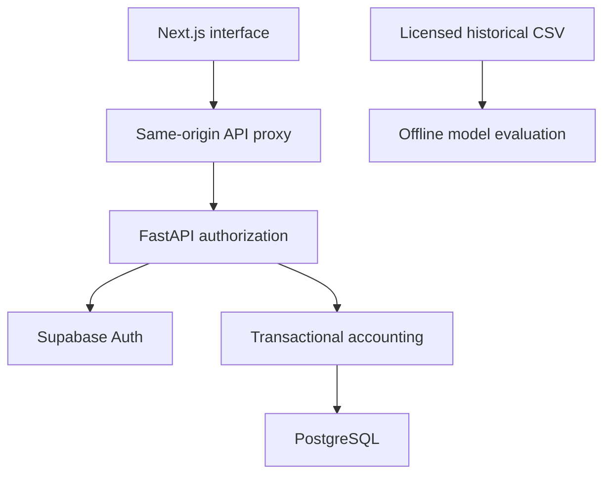

# Architecture and migration decisions

## Existing code inspection

`Doublezippin44/Plutus-AI2` contains Django views, username/password auth, chat persistence, financial profile and allocation models. There was no README at the root. The repository also tracks a virtual environment and SQLite database; do not copy these into new deployments. Existing settings and database contents were not harvested for credentials or user data.

The chat view uses substring-based symbol lookup and yfinance. It appends a quote with the user's preferred currency without FX conversion, swallows market-data exceptions, and does not provide a validated forecasting engine. This is unsuitable as a production data source. Existing user passwords are not imported into Supabase. Migration will require an explicit account-link or reset plan.

## Boundaries

The frontend is Next.js App Router with strict TypeScript. Plain CSS and small React components are used initially instead of introducing a full UI/state library before workflows stabilize. Backend is FastAPI with SQLAlchemy. SQLite is development/test-only, with `BEGIN IMMEDIATE` serializing writers. PostgreSQL uses account row locks and transaction-scoped advisory locks for first-account creation. Both paths need independent validation before launch.

Tables: users and sessions (development only), accounts, positions, orders, cash ledger, watchlist. Account kind is manual or paper. Each user/kind is unique. Request keys are unique per account and bound to a payload fingerprint. Orders, balances, positions and ledger changes commit atomically. Monetary source-of-truth is integer paise. Pooled cost is allocated proportionately with half-up rounding; closing a position consumes the entire remaining cost pool.

Portfolio valuation and unrealized P&L are null without market prices. They must never be inferred from purchase prices. The UI displays cost basis separately. Watchlist identifiers are validated syntactically but not against an exchange instrument catalog.

## Authentication flow

Development: PBKDF2-SHA256 password hash → random session token → only token digest persisted → HttpOnly SameSite=Strict cookie → user-scoped queries. Logout deletes the session digest.

Production: server calls Supabase password auth → HttpOnly Secure cookie → every private request calls `/auth/v1/user` to authenticate. No client-supplied user ID is trusted. Supabase secrets never enter browser bundles. This flow requires live verification and fuller session lifecycle controls.

CSRF: mutating browser endpoints require an exact configured Origin. Frontend and API are joined by a same-origin reverse proxy. Production allowed origin must be an HTTPS origin, with no wildcard.

## Future payment and execution flows — NOT IMPLEMENTED

Subscription checkout: authenticated request → configured plan catalog → gateway order/subscription → verified webhook → reconcile amount/currency/user/provider state → transactional entitlement. Investment funds never enter these records.

Broker execution: authenticated request → authorization/feature gates → explicit review and confirmation → broker adapter → persisted broker order ID → reconcile actual status. No live order path exists in this release. `/api/v1/broker/orders` returns 403 for an authenticated caller.

Upstox sandbox documentation was checked on 2026-11-16. It requires a sandbox app/token; sandbox coverage is phased. There is no claim that OAuth, holdings or every order endpoint exists in sandbox. Source: https://upstox.com/developer/api-documentation/sandbox/.

## Threat model / outstanding controls

- Cross-user record access: ownership derived from verified identity; tested locally.
- Concurrent spending and duplicate submission: transactional account lock + payload-bound idempotency; tested on SQLite, PostgreSQL pending.
- Numeric abuse: bounded integer quantities, finite positive two-decimal prices; tested.
- CSRF: exact origin; tested. Add production reverse-proxy origin tests.
- Stolen sessions: Secure/HttpOnly production cookie, one-hour expiry; fuller revocation and MFA outstanding.
- DB compromise: RLS denies browser access; backend currently requires privileged ownership. Add least-privilege role policies, field encryption where needed, key rotation and audits.
- Brute force: process-local rate limiter is temporary. Redis-backed per-account/IP limits are a launch blocker. Proxy IP handling needs deployment verification.
- AI prompt injection: AI tools are not exposed yet. Scoped tool registry, retrieval provenance and tool-call budgets must precede enablement.
- Public deployment: shell/readiness preview only until auth/database/monitoring and security checks pass. No payment or live trade is permitted.

No legal approval is asserted. Independent review must determine applicable market-data, research, advice, brokerage, payments and privacy obligations before enabling the corresponding activities.
